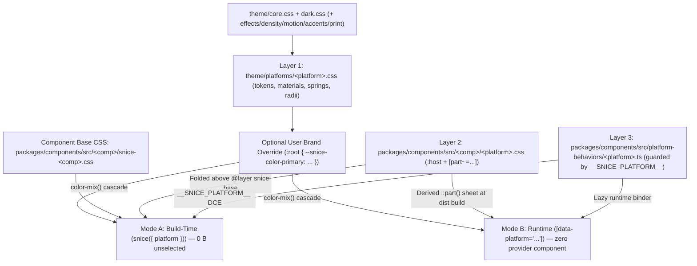

# Platform Skins — Technical Architecture

This document defines how Snice achieves **dead-on, indistinguishable, contemporary native visuals AND behaviors** per platform (`ios`, `material`, `windows`, `macos`) with **zero runtime provider overhead and 0 bytes for unused platforms**, integrated cleanly with the verified codebase on disk:
- Modular `color-mix()` theme slices (`packages/components/src/theme/core.css`, `dark.css`, `effects.css`, `density.css`, `motion.css`, `accents.css`, `print.css`, `theme.css`)
- Bundler plugin (`packages/plugin/src/core.ts`, `css.ts`, `chunking.ts`, `templates.ts`, `types.ts`, `vite.ts`, `rollup.ts`)
- Component catalog (`packages/components/src/` — 135 component dirs, 1 in `.wip` [`spreadsheet`], 134 released; 129 already expose `part="..."`, 5 lack `part="..."`: `availability`, `booking`, `calendar`, `doc`, `nav`)
- Distribution & package contract (`rollup.config.js`, `package.json`, `tests/package-contract.test.ts`, `tests/live/matrix/`, `tests/playwright.config.ts`)

---

## 1. Non-Negotiable Principles

1. **Dead-on indistinguishable visual & behavioral fidelity (User-provided)**:
   - Simplifying the architecture (dropping the recipe IR/generator and `<snice-theme>` JS provider) MUST NOT lower the fidelity bar. Every platform skin must look and feel indistinguishable from real contemporary native controls and surfaces across every supported state, mode, and accessibility preference — never generic approximate skins.
2. **Most contemporary official specifications (User-provided)**:
   - Every platform story MUST pin and verify the current official specification at implementation time (never legacy iOS 16, Material 2, or Fluent 1 patterns):
     - **iOS**: **iOS 26+ Liquid Glass / current Apple HIG** — Liquid Glass floating control layer over full-bleed content (regular vs clear glass, specular rim highlights, adaptive vibrancy), interactive glass press/drag magnification & morphing (toggles, sliders, segmented controls, tab-bar morph/condense on scroll), concentric corner geometry, spring-driven sheet detents & rubber-band physics, safe-area & light/dark/reduced-transparency/increased-contrast fidelity.
     - **Android**: **Material 3 Expressive (`m3.material.io`)** — M3 Expressive spring physics (spatial vs effects springs), shape morphing on press/selection (button/chip/toggle shape transitions), floating toolbars, connected button groups, updated M3 slider handle & stop indicators, tonal surface container hierarchy, pointer-origin state-layer ripple, FAB/app-bar/sheet/switch/text-field/chip anatomy, light/dark & high-contrast fidelity.
     - **Windows**: **Windows 11 Fluent 2 / current WinUI 3** — Mica / Mica Alt surface hierarchy, Acrylic transient surfaces (menus/flyouts/tooltips), 1px top-lit elevation strokes, Fluent 2 press/hover micro-interactions, WinUI 3 dual-stroke focus visuals, desktop density/keyboard/pointer conventions, contemporary Fluent motion.
     - **macOS**: **macOS 26+ Liquid Glass / current AppKit HIG** — Liquid Glass sidebars/toolbars/floating controls adapted to desktop pointer density, concentric radii, macOS focus rings, spring sheets/popovers, desktop keyboard & menu ergonomics.
3. **Full-catalog element equivalence discipline (preserving `SNICE-202`)**:
   - Every released Snice component (134 components) is classified per platform as:
     - **Direct native analogue** (matches exact native control anatomy, metrics, states, motion, and interaction — e.g. `switch`, `button`, `input`, `slider`, `tabs`, `modal`, `drawer`, `checkbox`, `radio`, `select`, `nav`, `chip`, `toast`/`alert`, `progress`, `tooltip`, `menu`/`dropdown`).
     - **Official pattern composition** (combines contemporary official patterns — e.g. `date-picker`, `command-palette`, `breadcrumbs`, `stepper`, `accordion`, `form-layout`, `card`, `banner`).
     - **Non-native Snice capability** (e.g. `kanban`, `gantt`, `table`, `chart`, `work-order`, `invoice`, `flow`, `code-block`, `calendar`) — explicitly styled and structured according to the target platform's official layout, hierarchy, typography, surface, chrome, density, and accessibility guidance so it looks purposefully crafted for that platform, never like a reskinned default or another platform's control.
4. **"One class per component, one superset template. Platform = CSS + tree-shakeable micro-behaviors."**
   - Single `@element('snice-<name>')` class, single standard import path (`import 'snice/components/<name>/snice-<name>'`), single repo, single version stamp.
   - Zero `<snice-theme>` JS provider, zero custom recipe IR/DSL, zero 670 duplicate component entrypoints.
   - **0 bytes** for unselected platforms in build-time single-platform apps (`snice({ platform })`).

---

## 2. Three-Layer Platform Architecture (Two Pure-CSS Layers + Tree-Shakeable Behaviors)

### 2.1 Layer 1 — Platform Token & Material Layer (`packages/components/src/theme/platforms/<platform>.css`)

Layered on top of Snice's modular `theme/core.css` (247 lines) and `dark.css` (136 lines), which already compute hovers, subtle surfaces, focus rings, selection overlays, alpha tints, and glows via CSS `color-mix()` from semantic seeds:
- Overrides semantic seeds, tonal/vibrancy surface containers, native typography stacks & tracking, concentric/platform radius scales, elevation shadows, platform material variables (e.g. Liquid Glass regular/clear translucency + specular rim border + backdrop blur/saturate; Material 3 tonal elevation steps & state-layer opacities; Windows Mica/Mica Alt + Acrylic tint/blur + 1px top-lit strokes), and contemporary spring/easing curves (`--snice-ease-spring`, spatial vs effects spring tokens).
- **Brand-override preservation**: Never breaks `color-mix()` derivation — overriding `--snice-color-primary` in user CSS after the theme import automatically re-tints all derived interactive tokens in light and dark modes with zero JS.
- **Accessibility & progressive enhancement**: Every platform token file ships:
  - `@supports not (backdrop-filter: blur(1px))` purpose-built opaque/tinted platform fallback (never unstyled default).
  - `@media (prefers-reduced-transparency: reduce)` solid high-legibility material fallback.
  - `@media (prefers-contrast: more)` and `@media (forced-colors: active)` crisp contrast & border preservation.
  - `@media (prefers-reduced-motion: reduce)` and `[data-motion="reduce"|"off"]` calm platform-appropriate motion alternatives.
- **Dual-mode selector hygiene**:
  - Single-platform root file `theme/platforms/<platform>.css` targets `:root` + dark blocks matching `dark.css:69-71` (`[data-theme="dark"]` and `@media (prefers-color-scheme: dark) { :root:not([data-theme]), :root[data-theme="auto"] }`) so custom `[data-theme="brand"]` blocks are never clobbered.
  - Runtime multi-platform sheet `dist/components/theme/platforms/<platform>-scoped.css` scopes all token overrides strictly under `[data-platform="<platform>"]` (with `[data-platform="<platform>"][data-theme="dark"], [data-theme="dark"] [data-platform="<platform>"]` and `prefers-color-scheme: dark` equivalents) so multiple loaded platforms never collide on `:root` and nested `[data-platform="..."]` subtrees override cleanly without leaking outward.

### 2.2 Layer 2 — Colocated Component CSS Layer (`packages/components/src/<comp>/<platform>.css`)

Colocated alongside each component whose anatomy, geometry, materials, states, or non-native platform chrome differs from token-only inheritance.

**Strict plain-CSS authoring contract (single source of truth for Mode A and Mode B)**:
1. Target **only** `:host` (with optional host attribute/pseudo selectors like `:host([variant="primary"])`, `:host([disabled])`, `:host([size="small"])`) and `[part~="<name>"]` (with optional `:hover`, `:focus-visible`, `:active`, `::before`, `::after`).
2. Never target private internal class names (`.switch-track`) or descendants after `[part~="..."]`.
3. Use Snice's established state-part convention (verified in `snice-switch.ts:138,156`, `snice-button.ts:110`, `snice-modal.ts:85,94`, `snice-radio.ts:121`, `snice-select.ts:273`) — e.g. `part="track track-checked"`, `part="thumb thumb-checked thumb-pressed"`, `part="base base-open"`.
4. Never use `!important` to override base component rules.

**Why this contract works identically across Mode A and Mode B in all 3 browser engines**:
- **Mode A (Build-time shadow folding via `snice({ platform })`)**:
  - Selectors (`:host`, `[part~="track-checked"]`) are natively valid inside the component's own Shadow DOM stylesheet — zero selector rewriting needed.
  - Works at **arbitrary Shadow DOM nesting depth** (inside Snice `@element` pages, composite components, light DOM, React, Vue, Svelte, Yew, Leptos, Blazor).
  - The plugin wraps the component's base CSS in `@layer snice-base{...}` and appends minified `<comp>/<platform>.css` outside the base layer. By CSS Cascade Layers (Baseline Widely Available: Chromium 99+, Firefox 97+, Safari/WebKit 15.4+), every platform rule deterministically beats any selector specificity inside `@layer snice-base` with zero `!important` hacks, while user external `::part()` rules still beat shadow styles.
- **Mode B (Runtime `[data-platform="
"]` multi-platform scoping)**:
  - At distribution build time (`rollup.config.js`), all `<comp>/<platform>.css` files are deterministically mapped 1:1 into `dist/components/theme/platforms/<platform>-scoped.css`:
    - `:host` → `[data-platform="
"] snice-<comp>`
    - `:host(<sel>)` → `[data-platform="
"] snice-<comp><sel>`
    - `[part~="<name>"]` → `[data-platform="
"] snice-<comp>::part(<name>)`
    - `:host(<sel>) [part~="<name>"]` → `[data-platform="
"] snice-<comp><sel>::part(<name>)`
  - Works natively across **Chromium, Firefox, and WebKit** with zero `:host-context()` (which Firefox does not support) and zero JS provider.

### 2.3 Superset Template Helper Nodes (`data-platform-only`)

When a contemporary platform requires a dedicated non-semantic visual layer inside a component's shadow DOM (e.g. Material ripple container, iOS Liquid Glass interactive specular lens, M3 slider stop-indicator track):
- Authored in the canonical template with `hidden` + `data-platform-only="<platform>"` (comma-separated if shared by multiple platforms, e.g. `data-platform-only="ios,macos"`).
- Default and non-matching platforms keep it `hidden` (zero visual, layout, or accessibility impact).
- The active platform's `<comp>/<platform>.css` unhides and styles it via `[part~="..."]`.
- In Mode A (`snice({ platform })`), `packages/plugin/src/templates.ts` strips static elements whose `data-platform-only` does not include the selected platform → **0 bytes** in every other platform's build.

### 2.4 Layer 3 — Per-Platform Tree-Shakeable Behavior Modules (`packages/components/src/platform-behaviors/`)

Pure CSS covers ~85–90% of platform fidelity; the remaining ~10–15% of contemporary native interaction physics that CSS alone cannot express lives in dedicated, side-effect-free, tree-shakeable behavior modules — one entry per platform:

| Platform Module | Contemporary Native Behaviors Implemented (Browser-Expressible) |
|---|---|
| `platform-behaviors/ios.ts` | Interactive Liquid Glass press/drag magnification & thumb-stretch physics on `snice-switch` & `snice-slider`; segmented-control sliding glass pill indicator (`snice-tabs` / `snice-segmented`); spring-driven bottom-sheet drag detents & velocity dismiss with rubber-band edge resistance (`snice-drawer` / sheet `snice-modal`); tab-bar scroll condense/morph (`snice-nav` / `snice-tabs`). |
| `platform-behaviors/material.ts` | Pointer-origin & keyboard-centered state-layer ripple (`--snice-ripple-x`, `--snice-ripple-y`, `--snice-ripple-size`) on `snice-button`, `snice-switch`, `snice-checkbox`, `snice-radio`, `snice-tab`, `snice-chip`; M3 Expressive press/selection shape-morph coordination & connected button-group neighbor corner response; updated M3 slider value-indicator & stop-dot interaction. |
| `platform-behaviors/windows.ts` | Fluent 2 pointer-proximity / press micro-scale feedback, WinUI 3 keyboard-vs-pointer dual-stroke focus distinction, Windows desktop menu/flyout/dialog keyboard & escape ergonomics. |
| `platform-behaviors/macos.ts` | AppKit desktop Liquid Glass sidebar/toolbar scroll-edge vibrancy state (`data-scrolled`), spring sheet/popover presentation & dismissal coordination, macOS desktop keyboard & focus-ring ergonomics. |

**Strict tree-shaking & safety rules**:
- Every component hook is guarded by the compile-time constant `__SNICE_PLATFORM__`:
  - `snice({ platform: 'ios' })` defines `__SNICE_PLATFORM__ = "ios"` → Rollup/Vite/Terser dead-code-eliminates `material.ts`, `windows.ts`, and `macos.ts` to **0 bytes**.
  - `snice({ platform: 'default' })` (or no platform) defines `__SNICE_PLATFORM__ = "default"` → **0 bytes** of all 4 behavior modules.
- In runtime multi-platform mode (`platform` omitted / `'multi'`, e.g. Storybook/showcases), an opt-in lazy binder (`packages/components/src/platform-behaviors/runtime.ts`) observes `[data-platform]` ancestors and dynamically loads only the behavior module(s) actually present in the DOM.
- Every micro-behavior respects `prefers-reduced-motion: reduce` and `[data-motion="reduce"|"off"]`, cleans up all listeners/observers in `@dispose()`, never intercepts native form submission/validation/history/ARIA semantics, and never fakes OS-unavailable capabilities (like native haptics).

---

## 3. Bundler Plugin Integration (`packages/plugin/src/`)

Hooks cleanly into the existing `packages/plugin/src/` files verified on disk:

| File | Current Capability (Verified) | Platform Skins Extension |
|---|---|---|
| `packages/plugin/src/types.ts` | `SnicePluginOptions`, `SniceThemeOptions`, `validateOptions()` | Add `SnicePlatform = 'default' \| 'ios' \| 'material' \| 'windows' \| 'macos'` and `platform?: SnicePlatform`; fail fast on invalid values in `validateOptions()`. |
| `packages/plugin/src/vite.ts` & `core.ts` | Defines `__SNICE_DEV__` via Vite `config.define` and Rollup `replaceSniceDevIdentifier` | Also define/fold `__SNICE_PLATFORM__` (JSON-stringified active platform, or `'preserve'` when `dev: 'preserve'` library build / `'multi'` when runtime multi-platform is requested) so all unselected platform behavior branches DCE cleanly. |
| `packages/plugin/src/chunking.ts` | Tier 3 `snice-theme` matches `theme/[^/]+\.css` (line 114) | Extend to `theme/(?:platforms/)?[^/]+\.css` so platform token CSS routes into `snice-theme-[hash].css` in both Rollup `manualChunks` and Rolldown `advancedChunks`/`codeSplitting`. |
| `packages/plugin/src/css.ts` | `SNICE_THEME_SLICE_ID_RE`, `isThemeCssId()`, `extractTopLevelRootAllowlist()`, `pruneThemeFeatureBlocks()`, `pruneThemeCss()`, `transformCssModule()` | Recognize `theme/platforms/*.css` as Snice theme slices; in `transformCssModule()`, when `platform` is non-default and a Snice component module has a colocated `<comp>/<platform>.css`, wrap base CSS in `@layer snice-base{...}` and fold minified `<comp>/<platform>.css` into the static `css\`...\`` call. |
| `packages/plugin/src/templates.ts` | `minifyHtmlQuasis()` / `transformTemplates()` (`O(L)` linear HTML scanner) | When `platform` is set, strip static elements with `data-platform-only="<list>"` not matching `platform` in `O(L)` time while preserving exact quasi count & dynamic expressions. |
| `packages/plugin/src/core.ts` | `resolveId`, `load`, `transform`, `generateBundle` | Auto-layer `theme/platforms/<platform>.css` after imported `theme.css` / `core.css` (deduplicating if user already imported it explicitly) while preserving user brand CSS order so `--snice-color-primary` overrides always win. |

---

## 4. Distribution & Package Contract (`rollup.config.js` & `package.json`)

- `rollup.config.js`:
  - Extend `copy-theme` (`rollup.config.js:433-449`) to copy `packages/components/src/theme/platforms/*.css` to `dist/components/theme/platforms/`.
  - Copy colocated `packages/components/src/<comp>/<platform>.css` files to `dist/components/<comp>/<platform>.css` so downstream npm consumers using `snice({ platform })` resolve them directly from `node_modules/snice/dist/components/`.
  - Generate `dist/components/theme/platforms/<platform>-scoped.css` (token layer scoped to `[data-platform="
"]` + 1:1 `::part()`-mapped component overrides) during `npm run build:distribution`.
  - Keep `sniceRollup({ dev: 'preserve' })` preserving `__SNICE_PLATFORM__` in published `dist/components/*.js` so downstream app bundlers (`snice({ platform })`) dead-code-eliminate unselected platforms! (When consumed without the plugin, `__SNICE_PLATFORM__` defaults safely via a lightweight fallback guard `typeof __SNICE_PLATFORM__ !== 'undefined' ? __SNICE_PLATFORM__ : 'default'` so unbundled/CDN/no-plugin apps never throw `ReferenceError`!)
- `package.json`:
  - Add `"./components/theme/platforms/*.css": "./dist/components/theme/platforms/*.css"` to `exports` (preserving `"types"`-first ordering on all JS exports checked by `tests/package-contract.test.ts`).
  - Keep all existing deep imports (`snice/components/<name>/snice-<name>`) 100% backwards compatible.

---

## 5. Strict Visual & Behavioral Conformance Gate

Reuses Snice's existing verification stack (zero bespoke harness prerequisites):
1. **Pinned Guideline Provenance**: Each platform profile pins its exact official guideline release & capture date (iOS 26+ HIG, Material 3 Expressive `m3.material.io`, Windows 11 Fluent 2 / WinUI 3, macOS 26+ HIG) plus trademark/font/icon licensing verification.
2. **3-Engine Playwright Conformance (`tests/playwright.config.ts`: Chromium, Firefox, WebKit + `tests/live/matrix/` visual tier)**:
   - Pixel-level & computed-style geometry assertions on every marquee native analogue (`switch`, `button`, `input`, `slider`, `tabs`, `modal`, `drawer`, `nav`, `checkbox`, `radio`, `select`, `card`, `chip`, `toast`/`alert`) AND representative non-native Snice elements (`table`, `kanban`, `gantt`, `chart`, `calendar`).
   - Behavioral interaction assertions: pointer-origin ripple coordinates & decay, iOS glass drag/press magnification & sheet detent snap/dismiss + scroll coexistence, M3 shape-morph border-radius transitions, WinUI dual-stroke keyboard vs pointer focus, macOS focus rings & Escape/keyboard navigation.
   - Mode matrix: light, `[data-theme="dark"]`, `@media (prefers-color-scheme: dark)`, `prefers-reduced-motion: reduce`, `prefers-reduced-transparency: reduce`, `prefers-contrast: more` / `forced-colors`, RTL, custom `--snice-color-primary` `color-mix()` brand cascade, Mode A nested Shadow DOM, Mode B nested `[data-platform="..."]` live switching without losing state/focus.
   - Named visual review sign-off by the main session (per `.ai/policies/workflow.md:39-49`, visual eyes-on review is never delegated to a subagent).
3. **Cross-Framework Parity**: Vanilla HTML vs React (`adapters/react/`) computed-style & interaction parity tests proving zero adapter rewrites; documented contract verification for Vue, Svelte, Yew, Leptos, and C#/Blazor.
4. **Zero-Cost Bundle & Performance Budgets (`snice({ report: { budgets } })`)**:
   - `0 B` of unselected platform CSS, unselected `data-platform-only` markup, and unselected behavior JS in every single-platform build.
   - Token layer per platform `< 3.5 KB` gzipped; per-component CSS override `< 1.2 KB` gzipped; per-platform behavior module `< 2 KB` gzipped; `0 B` regression on default un-skinned builds; `snice-theme-[hash].css` hash stability across app code edits.
