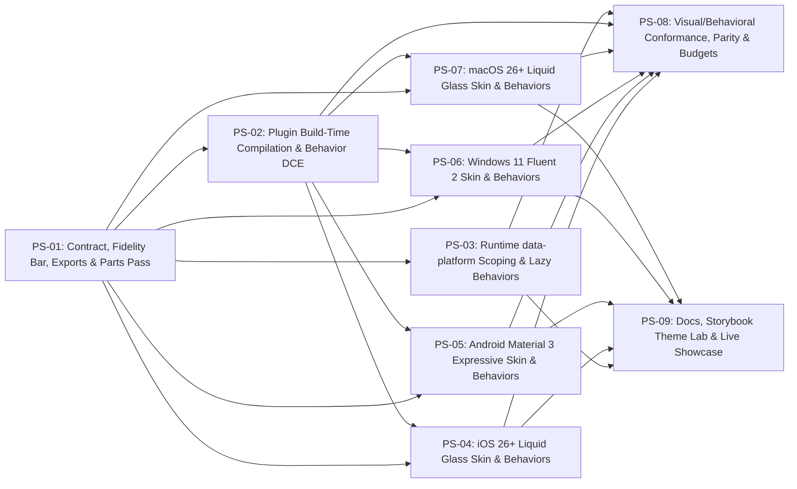

# Platform Skins — Design Index

- **Design ID**: `platform-skins`
- **Status / Current Phase**: `stories-ready` — durable design (`index.md`, `architecture.md`) and 9 modernized, self-contained stories (`PS-01`..`PS-09`) authored under `.local/board/ready/`.
- **Replaces Legacy Epic**: `.board/backlog/SNICE-199-*.md` .. `SNICE-216-*.md` (18 legacy Aug 12 stories — see full Disposition Table below; `.board/backlog/SNICE-*.md` files left untouched pending coordinated board update).
- **Next Unfinished Action**: Apply recommended disposition updates to `.board/backlog/SNICE-199..216`, commit `.local/design/platform-skins/`, then begin implementation with `PS-01`.

---

## Attribution

### User-Provided Details
1. **Non-negotiable fidelity bar (verbatim)**:
   - *"and those themes and behaviors need to be dead on so they are indistinguishable per platform"*
   - *"make sure those are the most contemporary behaviors"*
   - Zero fidelity compromise: dropping the legacy recipe IR (`SNICE-201`) and runtime `<snice-theme>` JS provider (`SNICE-200`) simplifies architecture and delivers 0-byte unused-platform cost — it does **NOT** relax the visual or behavioral fidelity bar from `SNICE-199`, `SNICE-203`–`SNICE-208`, and `SNICE-212`.
   - Every platform profile MUST target the **most contemporary official platform design system and interaction patterns** (NEVER legacy iOS 16 / Material 2 / Fluent 1 approximations) and pin + verify the current official specification at implementation time:
     - **iOS (iOS 26+ Liquid Glass / current Apple HIG)**: Liquid Glass floating control layer over full-bleed content (regular vs clear glass, specular rim highlights, adaptive vibrancy), interactive glass press/drag magnification & morphing (toggles, sliders, segmented controls, tab-bar morph/condense on scroll), concentric corner geometry, spring-driven sheet detents & rubber-band physics, safe-area & light/dark/reduced-transparency/increased-contrast fidelity.
     - **Android (Material 3 Expressive — current `m3.material.io`)**: M3 Expressive spring physics (spatial vs effects springs), shape morphing on press/selection (button/chip/toggle shape transitions), floating toolbars, connected button groups, updated M3 slider handle & stop indicators, tonal surface container hierarchy, pointer-origin state-layer ripple, FAB/app-bar/sheet/switch/text-field/chip anatomy, light/dark & high-contrast fidelity.
     - **Windows (Windows 11 Fluent 2 / current WinUI 3)**: Mica / Mica Alt surface hierarchy, Acrylic transient surfaces (menus/flyouts/tooltips), 1px top-lit elevation strokes, Fluent 2 press/hover micro-interactions, WinUI 3 dual-stroke focus visuals, desktop density/keyboard/pointer conventions, contemporary Fluent motion.
     - **macOS (macOS 26+ Liquid Glass / current AppKit HIG)**: Liquid Glass sidebars/toolbars/floating controls adapted to desktop pointer density, concentric radii, macOS focus rings, spring sheets/popovers, desktop keyboard & menu ergonomics.
   - **Non-native Snice elements** (e.g. `kanban`, `gantt`, `table`, `chart`, `work-order`) MUST explicitly follow each target platform's official design language (preserving `SNICE-202` equivalence & fallback discipline) — never generic reskinned defaults.
2. **Core skin principle** (from `.research/platform-skins-2026-08-20.md` + current architectural direction):
   - *"One class per component, one superset template. Platform = CSS."*
   - One source of truth, one repo, one version stamp — no drift by construction, no separate elements per platform, no inheritance/wrapping.
   - *"No matrix of can't"*: every component works under every platform.
3. **Dropped obsolete Aug 12 machinery**:
   - **NO** custom recipe IR / DSL / generator (`SNICE-201`).
   - **NO** runtime `<snice-theme>` JS provider or versioned runtime asset loader (`SNICE-200`, `SNICE-210`).
   - **NO** 670 duplicate component entrypoints (`snice/components/<platform>/<name>`).
4. **Two pure-CSS layers + tree-shakeable micro-behaviors per platform** (`ios`, `material`, `windows`, `macos`, plus optional future enterprise profiles like `salesforce`/`fiori`):
   - **Token layer**: `packages/components/src/theme/platforms/<platform>.css` layered on top of the modular `color-mix()` seed-derived `theme/core.css` + `dark.css` (~20–35 semantic/motion/radius/elevation/material tokens; user brand overrides like `--snice-color-primary` cascade automatically through `color-mix()`).
   - **Component layer**: colocated `packages/components/src/<comp>/<platform>.css` targeting the additive `part="..."` shadow surface wherever component geometry, materials, or states diverge from default tokens (both native analogues AND non-native Snice elements where platform-specific layout/chrome is needed).
   - **Tree-shakeable platform behavior modules**: anywhere pure CSS cannot achieve 100% indistinguishable native feel/interaction (pointer-origin ripple, detent drag gestures, interactive glass press/drag magnification & thumb slide physics, M3 expressive shape morphing/spring physics, tab-bar scroll condense, keyboard/focus behaviors), dedicated per-platform behavior modules are injected ONLY for the selected platform by `snice({ platform })` (**0 bytes** in other platforms' builds) or lazily bound under `[data-platform="..."]`.
5. **Zero-cost build-time compilation** via `snice/vite` & `snice/rollup` (`snice({ platform: 'ios' | 'material' | 'windows' | 'macos' })`):
   - Users keep standard imports (`import 'snice/components/button/snice-button'`).
   - Plugin folds ONLY the selected platform's `<comp>/<platform>.css`, puts platform token CSS in cache-stable `snice-theme-[hash].css`, prunes unused tokens, tree-shakes unused platform behavior modules via `__SNICE_PLATFORM__`, and strips unused platform-only `hidden` helper nodes → **0 bytes for unused platforms**.
6. **Pure-CSS runtime multi-platform switching**: `[data-platform="<platform>"]` scoping without a JS provider (for showcases, docs, Storybook, and multi-tenant apps), plus optional lazy behavior binding.
7. **Cross-framework for free & maximally guessable plain CSS**: standard Web Components + `--snice-*` tokens + `::part()` work identically in Vanilla, React, Vue, Svelte, Yew, Leptos, and C#/Blazor with zero adapter rewrites and no custom DSL.

### Skill-Authored Details
- Verified codebase audit against `packages/components/src/` (135 component directories; 1 in `.wip` [`spreadsheet`]; **134 released**; **129 already expose `part="..."`**, only **5** lack `part="..."`: `availability`, `booking`, `calendar`, `doc`, `nav`), `packages/components/src/theme/` (modular `color-mix()` slices: `core.css`, `dark.css`, `effects.css`, `density.css`, `motion.css`, `accents.css`, `print.css`, `theme.css`), `packages/plugin/src/` (`core.ts`, `css.ts`, `chunking.ts`, `templates.ts`, `types.ts`, `vite.ts`, `rollup.ts`), `rollup.config.js`, and `package.json`.
- Dual-mode Shadow DOM / light-DOM CSS strategy (`@layer snice-base` folding for arbitrary Shadow DOM depth in Mode A + 1:1 derived `[data-platform="..."] snice-<comp>::part(...)` for Chromium/Firefox/WebKit in Mode B without `:host-context()`).
- Vertical-slice story decomposition (`PS-04`..`PS-07` each co-owning a platform's contemporary spec pinning, visuals, non-native catalog treatment, AND native behavior module so visual and behavioral fidelity never drift apart).

---

## Artifact Map

| Artifact | Purpose |
|---|---|
| [index.md](index.md) | Master index, settled decisions ledger, legacy `SNICE-199`..`SNICE-216` disposition table, and modernized `PS-01`..`PS-09` story map |
| [architecture.md](architecture.md) | Concrete technical architecture tying platform tokens, `part="..."` CSS, `snice({ platform })` plugin compilation, `[data-platform="..."]` runtime scoping, tree-shakeable micro-behaviors, cross-framework parity, and strict visual/behavioral conformance gates to actual repo code |

---

## Settled Decisions Ledger

| ID | Decision | Source | Affects Stories |
|---|---|---|---|
| **D-PS-1** | **Dead-on indistinguishable visual & behavioral fidelity + most contemporary specs**: Every platform profile must be visually and behaviorally indistinguishable from its pinned contemporary official design system (iOS 26+ Liquid Glass, Android Material 3 Expressive, Windows 11 Fluent 2 / WinUI 3, macOS 26+ Liquid Glass) — never approximate or legacy skins, including explicit platform-guideline treatment for non-native Snice elements. | User-provided | All (`PS-01`..`PS-09`) |
| **D-PS-2** | **One class, one superset template, Platform = CSS + tree-shakeable micro-behaviors**: Every component keeps a single class and canonical template; optional platform-only helper nodes (e.g. Material ripple, iOS glass highlight lens) use `hidden` + `data-platform-only="<platform>"`. | User-provided | `PS-01`, `PS-02`, `PS-04`..`PS-07` |
| **D-PS-3** | **Drop `<snice-theme>`, recipe IR/generator, runtime asset loader, and 670 duplicate component entrypoints**: Plain CSS + `snice({ platform })` build-time compilation + `__SNICE_PLATFORM__` behavior tree-shaking replaces all four without lowering the fidelity bar. | User-provided | All (`PS-01`..`PS-09`) |
| **D-PS-4** | **Two pure-CSS layers on top of modular `color-mix()` theme**: Token layer `packages/components/src/theme/platforms/<platform>.css` (preserving user `--snice-color-primary` `color-mix()` cascade) + colocated `packages/components/src/<comp>/<platform>.css` targeting `part="..."` wherever geometry, materials, or states diverge. | User-provided | `PS-01`, `PS-04`..`PS-07` |
| **D-PS-5** | **Dual-mode CSS compatibility (Mode A shadow-folded + Mode B `[data-platform]` light-DOM `::part()`)**: `<comp>/<platform>.css` targets ONLY `:host` and `[part~="<name>"]` (using Snice's existing state-part convention, e.g. `track-checked`, `base-open`, `base-disabled`). Mode A (`snice({ platform })`) folds `<comp>/<platform>.css` above `@layer snice-base` inside the component's shadow stylesheet (arbitrary Shadow DOM depth in all 3 engines, zero specificity wars, 0 bytes for unused platforms). Mode B derives `[data-platform="
"] snice-<comp>::part(...)` into `dist/components/theme/platforms/
-scoped.css` (Chromium, Firefox, WebKit with zero `:host-context()` and zero JS provider). | Skill-authored (grounded in Shadow DOM & Firefox `:host-context()` constraint) | `PS-01`..`PS-07` |
| **D-PS-6** | **Zero-cost plugin compilation (`snice({ platform })`)**: Standard component imports stay unchanged; plugin injects/layers the selected platform's token CSS into `snice-theme-[hash].css`, folds ONLY imported components' `<comp>/<platform>.css`, strips unselected `data-platform-only` template nodes, and defines `__SNICE_PLATFORM__` so unselected micro-behaviors dead-code-eliminate to 0 bytes. | User-provided | `PS-02`, `PS-04`..`PS-08` |
| **D-PS-7** | **Per-platform tree-shakeable behavior modules**: Wherever pure CSS cannot achieve 100% indistinguishable native feel (iOS glass press/drag magnification & morphing, sheet detents, tab-bar condense; Material pointer-origin ripple, expressive springs & shape morphing; Windows/macOS desktop micro-interactions & keyboard/focus ergonomics), ship tiny tree-shakeable behavior modules guarded by `__SNICE_PLATFORM__` (0 bytes for other platforms) and lazily bindable under `[data-platform="..."]`. | User-provided | `PS-02`, `PS-03`, `PS-04`..`PS-07` |
| **D-PS-8** | **Cross-framework for free**: Standard Web Components + `--snice-*` custom properties + `::part()` + `[data-platform]` require zero adapter rewrites across Vanilla, React, Vue, Svelte, Yew, Leptos, and C#/Blazor. | User-provided | `PS-01`, `PS-03`, `PS-08`, `PS-09` |
| **D-PS-9** | **Backwards compatibility & repo gates**: Default unwrapped/un-configured usage stays 100% unchanged; source `.css` files keep `var(--snice-*, fallback)` per `.ai/policies/style.md`; `package.json` `exports` preserves `types`-first ordering and sourcemap contracts (`tests/package-contract.test.ts`); core stays circular-free with >90% coverage. | Repository policy | All (`PS-01`..`PS-09`) |

### Open Questions
- None blocking `PS-01`..`PS-09`. Optional enterprise profiles (`fiori`, `salesforce`) are explicitly deferred until after `PS-09` ships.

---

## Disposition Table for Legacy Stories (`SNICE-199`..`SNICE-216`)

> Note: `.board/backlog/SNICE-199..216` were intentionally **not** edited in this pass. Apply these exact dispositions when updating `.board/backlog/`.

| Legacy ID | Legacy Title | Disposition | Replaced / Handled By | Rationale |
|---|---|---|---|---|
| **SNICE-199** | Define the platform theme contract and fidelity release bar | **Superseded** | `PS-01` | Replaces `<snice-theme theme platform>` contract with pure-CSS two-layer contract, `snice({ platform })`, and `[data-platform="..."]`; **preserves in full** the dead-on indistinguishable fidelity rubric, pinned contemporary guideline versions, browser-limit documentation, and trademark/provenance checks. |
| **SNICE-200** | Ship the scoped `snice-theme` web component | **Superseded** | `PS-03` | Drops `<snice-theme>` JS custom element completely; replaced by pure-CSS `[data-platform="..."]` scoping + `::part()` rules + optional lazy behavior binding with zero provider component. |
| **SNICE-201** | Generate platform themes from a canonical recipe IR | **Superseded (Dropped)** | `PS-02` | Drops custom recipe IR, DSL, and code generator completely; replaced by plain hand-authored CSS + `snice({ platform })` build-time compilation and `__SNICE_PLATFORM__` tree-shaking in `snice/vite` & `snice/rollup`. |
| **SNICE-202** | Map every element to native equivalents and guideline fallbacks | **Absorbed** | `PS-01`, `PS-04`..`PS-07` | Drops generator-IR coupling while **preserving full equivalence & fallback discipline**: `PS-01` defines the classification contract (direct analogue / composite / non-native guideline-derived) and completes `part="..."` across all 134 released components; `PS-04`..`PS-07` classify and style every native and non-native element (`kanban`, `gantt`, `table`, `chart`, `work-order`, etc.) under each target platform's contemporary design language. |
| **SNICE-203** | Match the iOS Liquid Glass visual language | **Superseded** | `PS-04` | Modernized to **iOS 26+ Liquid Glass** (regular vs clear glass, specular rim highlights, adaptive vibrancy, concentric corners, light/dark/reduced-transparency/increased-contrast) via pure-CSS `theme/platforms/ios.css` + colocated `<comp>/ios.css` on top of `color-mix()` `theme/core.css` + `dark.css`. |
| **SNICE-204** | Match iOS interaction, navigation, and motion behavior | **Absorbed** | `PS-04` | Co-owned in `PS-04` (vertical slice) so visual and behavioral fidelity stay indistinguishable: iOS 26+ spring physics, interactive glass press/drag magnification & morphing (switch, slider, segmented control), tab-bar scroll condense, and spring-driven sheet drag detents via tree-shakeable iOS behavior module. |
| **SNICE-205** | Match the current Android Material visual language | **Superseded** | `PS-05` | Modernized to **Material 3 Expressive** (tonal surface container hierarchy, shape scales, state layers, FAB/app-bar/sheet/switch/text-field/chip/slider anatomy, light/dark/high-contrast) via pure-CSS `theme/platforms/material.css` + colocated `<comp>/material.css`. |
| **SNICE-206** | Match Android interaction, navigation, and motion behavior | **Absorbed** | `PS-05` | Co-owned in `PS-05` (vertical slice): M3 Expressive spatial vs effects springs, shape morphing on press/selection, pointer-origin state-layer ripple, floating toolbars, connected button groups, and updated slider handle/stop-indicator interactions via tree-shakeable Material behavior module. |
| **SNICE-207** | Complete Apple and Android treatment for every element | **Absorbed** | `PS-01`, `PS-04`, `PS-05`, `PS-08` | Completing `part="..."` on the 5 remaining components (`PS-01`) + full-catalog classification & non-native treatment (`PS-04`, `PS-05`) + 134-component conformance audit (`PS-08`) achieves 100% indistinguishable catalog coverage without 670 duplicate entrypoints. |
| **SNICE-208** | Gate platform fidelity with real-device visual and interaction tests | **Superseded** | `PS-08` | Preserves the strict visual, pixel, contrast, layout, motion, and behavioral conformance rubric against pinned contemporary official references, grounded in Snice's 3-engine Playwright (`Chromium`, `Firefox`, `WebKit`) + `tests/live/matrix/` paint-level visual harness + named visual review sign-off. |
| **SNICE-209** | Document and demonstrate scoped platform themes | **Superseded** | `PS-09` | Updates human & AI docs (`docs/` + `docs/ai/`), adds pure-CSS `[data-platform]` Storybook contemporary theme lab & nested multi-platform showcase; drops `<snice-theme>` markup. |
| **SNICE-210** | Package platform themes with production-grade performance | **Superseded** | `PS-02`, `PS-08` | Drops runtime versioned asset loader; `snice({ platform })` compiles selected platform CSS & micro-behavior with 0 bytes for unused platforms, progressive enhancement fallbacks, GPU/compositing discipline, and automated size budgets. |
| **SNICE-211** | Expose the same platform theme contract in every language | **Absorbed** | `PS-01`, `PS-03`, `PS-08` | Standard Web Components + `--snice-*` tokens + `::part()` + `[data-platform]` work identically across Vanilla, React, Vue, Svelte, Yew, Leptos, and C#/Blazor with zero adapter rewrites or `<snice-theme>` wrappers. |
| **SNICE-212** | Add a Windows Fluent enterprise profile | **Superseded** | `PS-06` | Modernized to **Windows 11 Fluent 2 / WinUI 3** (Mica/Mica Alt, Acrylic transient surfaces, 1px top-lit elevation strokes, dual-stroke focus visuals, desktop micro-interactions & keyboard conventions); no longer blocked on legacy `SNICE-216` IR cost gate. |
| **SNICE-213** | Add an SAP Fiori Horizon enterprise profile | **Deferred** | *(Future optional enterprise profile)* | Deferred until `PS-01`..`PS-09` ship; pure-CSS + tree-shakeable behavior architecture allows adding `theme/platforms/fiori.css` + selective overrides later with zero plugin or core changes. |
| **SNICE-214** | Add a Salesforce Lightning enterprise profile | **Deferred** | *(Future optional enterprise profile)* | Deferred until `PS-01`..`PS-09` ship; pure-CSS + tree-shakeable behavior architecture allows adding `theme/platforms/salesforce.css` + selective overrides later with zero plugin or core changes. |
| **SNICE-215** | Release and maintain versioned platform profiles | **Absorbed** | `PS-01`, `PS-08` | Single-repo/single-version stamp removes independent per-profile semver/skew machinery; pinned contemporary guideline targets & provenance live in `PS-01`/`PS-04`..`PS-07`, automated compile/part/visual/budget gates live in `PS-08`. |
| **SNICE-216** | Measure and gate the marginal cost of each platform theme | **Superseded** | `PS-06`, `PS-07`, `PS-08` | Replaced by automated `snice({ report: { budgets } })` byte/compositing budgets (`PS-08`) and empirical proof of low marginal cost across `windows` (`PS-06`) and `macos` (`PS-07`) without sacrificing indistinguishable fidelity. |

---

## Modernized Story Map (`PS-01`..`PS-09`)

| Story ID | Title | Prerequisites | Board Status | Story Path |
|---|---|---|---|---|
| **PS-01** | Platform skin contract, contemporary fidelity bar, package exports & CSS parts completeness pass | None | `ready` | `.local/board/ready/PS-01.md` |
| **PS-02** | Zero-cost build-time platform compilation & behavior tree-shaking in `snice/vite` & `snice/rollup` (`snice({ platform })`) | `PS-01` | `ready` | `.local/board/ready/PS-02.md` |
| **PS-03** | Pure-CSS runtime multi-platform scoping (`[data-platform="..."]`) & lazy behavior binding | `PS-01` | `ready` | `.local/board/ready/PS-03.md` |
| **PS-04** | iOS 26+ Liquid Glass platform skin & contemporary native behaviors | `PS-01`, `PS-02` | `ready` | `.local/board/ready/PS-04.md` |
| **PS-05** | Android Material 3 Expressive platform skin & contemporary native behaviors | `PS-01`, `PS-02` | `ready` | `.local/board/ready/PS-05.md` |
| **PS-06** | Windows 11 Fluent 2 / WinUI 3 platform skin & contemporary desktop behaviors | `PS-01`, `PS-02` | `ready` | `.local/board/ready/PS-06.md` |
| **PS-07** | macOS 26+ Liquid Glass platform skin & contemporary desktop behaviors | `PS-01`, `PS-02` | `ready` | `.local/board/ready/PS-07.md` |
| **PS-08** | Strict visual & behavioral conformance harness, cross-framework parity & zero-cost bundle-budget gates | `PS-02`..`PS-07` | `ready` | `.local/board/ready/PS-08.md` |
| **PS-09** | Platform skins human + AI documentation, Storybook contemporary theme lab & live showcase | `PS-03`..`PS-07` | `ready` | `.local/board/ready/PS-09.md` |

> Parallelism note: After `PS-01`, `PS-02` and `PS-03` run in parallel. Once `PS-02` lands, **all 4 contemporary platform vertical slices (`PS-04`, `PS-05`, `PS-06`, `PS-07`) can proceed completely in parallel** with non-overlapping platform files.
